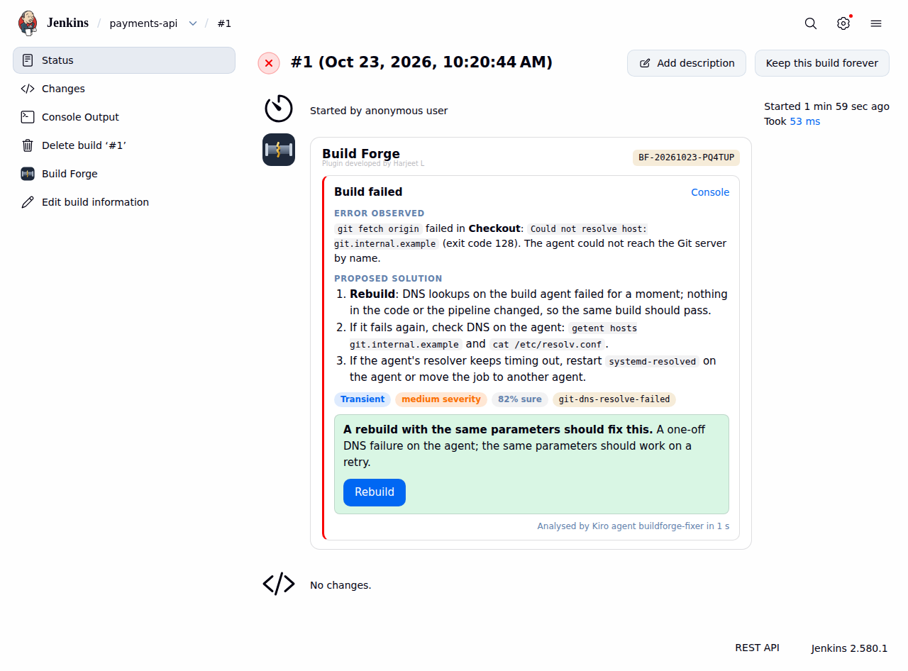
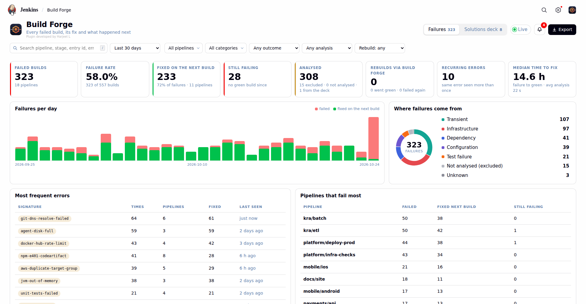
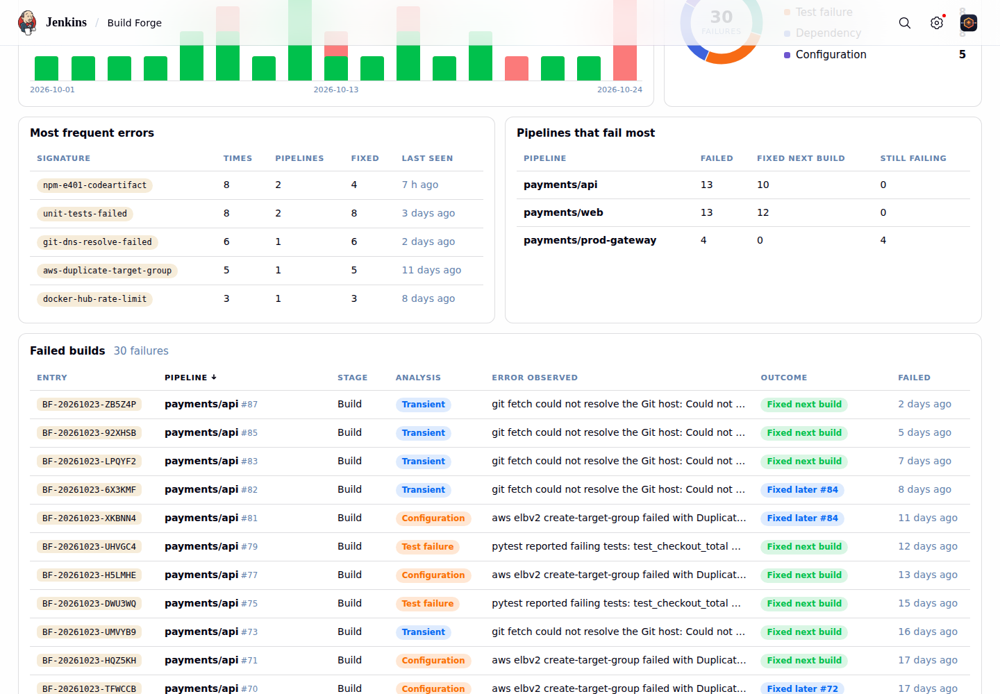
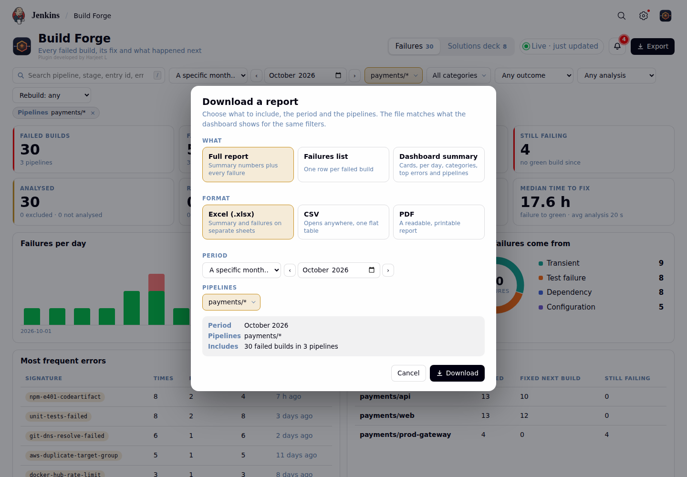
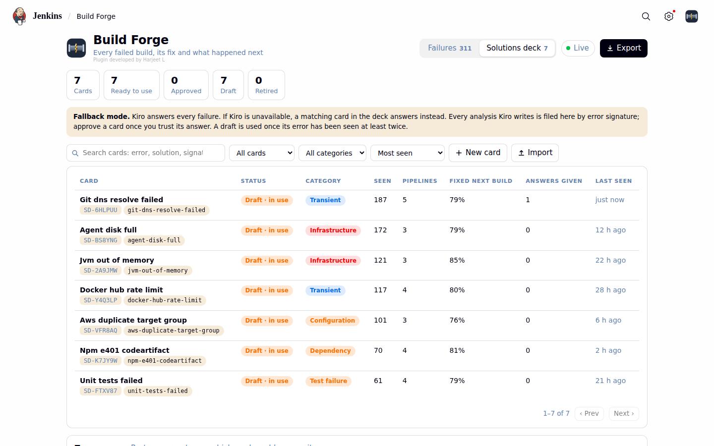
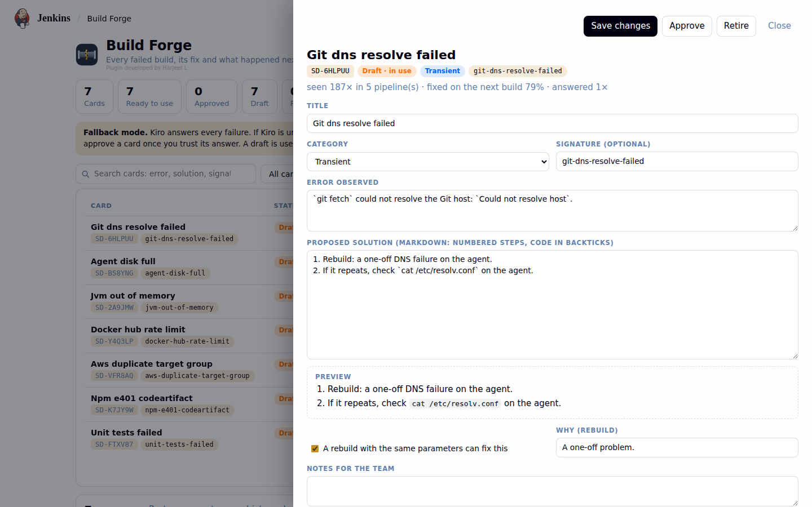
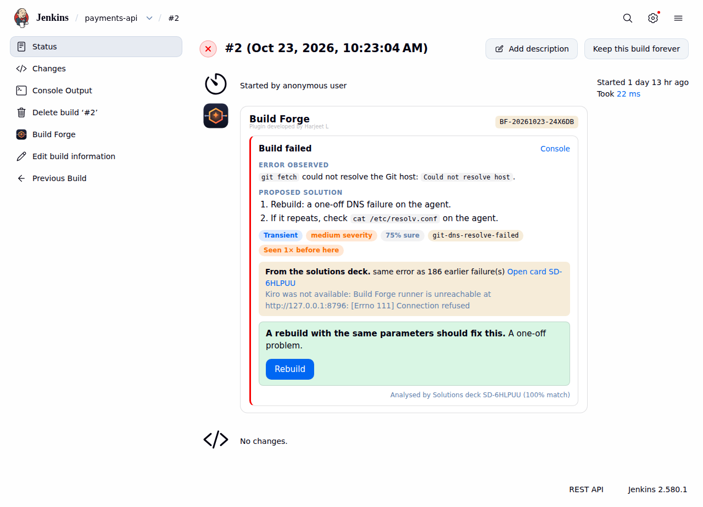
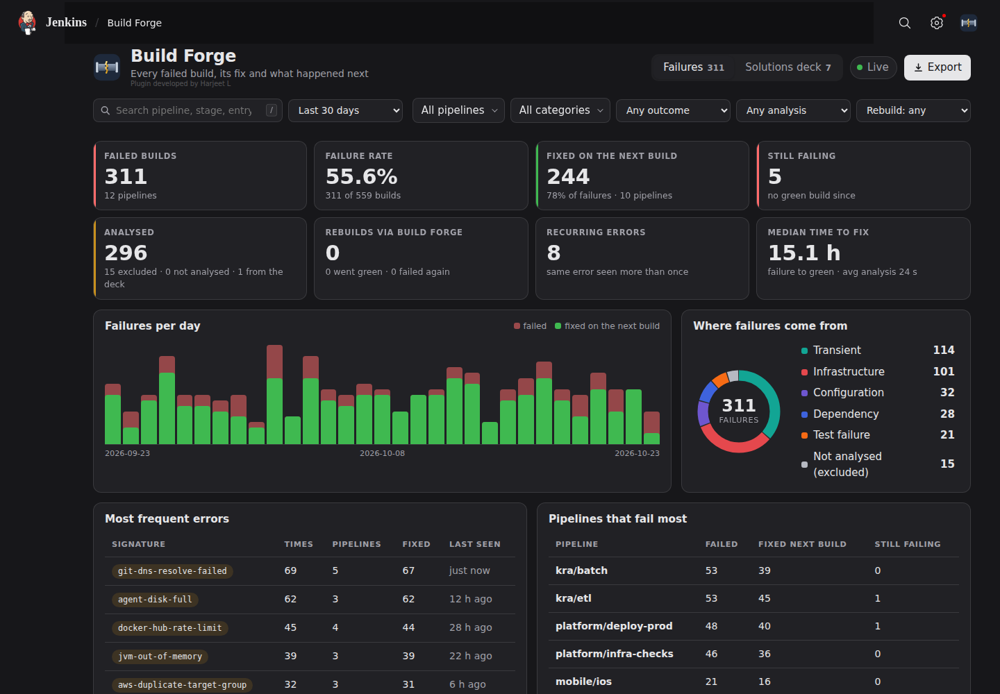

# Build Forge

**Every failed Jenkins build, read by an AI agent, with the fix shown on the build.**

Build Forge is a Jenkins add-on that analyses each failed build with an AI agent (Claude Opus 4.5 through the Kiro CLI),
shows the error and the proposed fix **under the failed stage**, and offers a **Rebuild** button only when a rebuild with the
same parameters can actually fix it. Every failure gets a unique entry id and an incident log on the Jenkins server, and an
dashboard shows **every** failed build plus stats such as *how many pipelines failed and were fixed on the next build*, and a
**solutions deck** keeps the answers to recurring errors so they can still be suggested when the AI is not available.



## What you get

- **No Jenkinsfile changes.** A global hook sees every build of every job (pipeline and freestyle).
- **Focused analysis.** Only the failing stage's output goes to the AI, with the history of the same error.
- **Structured answers.** The agent answers through one validated MCP tool call: error observed, proposed solution, category,
  severity, confidence, *can a rebuild fix it*, and a stable error signature. No free-text parsing.
- **Rebuild only when it helps.** The button appears when the agent says a rebuild can fix it; Jenkins re-checks the user's Build
  permission. Nothing is ever rebuilt automatically.
- **Unique entry per failure**, e.g. `BF-20261012-7RN2ZH`, and an incident log
  ([sample](docs/sample-incident.md)) with the build URL, written from the AI's answer. One JSON line per event for log shippers.
- **Dashboard** at `/buildforge/admin`: every failed build (job include/exclude only controls what is *analysed*), with search,
  period, pipeline (wildcards), category, outcome and rebuild filters, sortable columns, a detail drawer, failures per day,
  categories, recurring errors, rebuilds and how many went green, median time to fix. It follows the Jenkins theme (light and
  dark) and **updates live**: new failures slide in with a toast, numbers and charts animate.
- **Reports** for admins in **CSV, XLSX or PDF**, for a month, any period or chosen pipelines, as a list, a summary or both. They
  always match the filters on screen.
- **Solutions deck**: every analysis is filed on a card per kind of error (how often, in which pipelines, how often the next
  build went green). Review, edit and approve the cards. With no Kiro (or with `BF_DECK_MODE=first`, once you trust the deck) a
  matching card answers the failure, and the build page says so. Export and import the deck as JSON, CSV, XLSX or PDF.
- **Optional Teams alerts** for the categories you choose.
- **No chat.** Analysis only, on failed builds only.



| | |
|---|---|
|  |  |
|  |  |
|  |  |

## How it works

```
 Jenkins server                                                  Kiro / AI instance
 ┌─────────────────────────────────────────────┐                ┌──────────────────────────────────────┐
 │ Jenkins + Build Forge plugin                │                │ buildforge-runner (:8796)            │
 │   failed build ─► POST /api/v2/failure      │                │   kiro-cli chat --no-interactive     │
 │   every build  ─► POST /api/v2/build-result │                │     --agent buildforge-fixer         │
 │          ▼                                  │   POST         │        │ calls its one MCP tool      │
 │ buildforge service (127.0.0.1:8791) ────────┼──/analyze─────►│        ▼                             │
 │   cuts out the failing stage, entry id,     │                │   MCP server: submit_analysis        │
 │   incident logs, stats, Teams  ◄────────────┼── analysis ────┤                                      │
 └─────────────────────────────────────────────┘                └──────────────────────────────────────┘
```

Three parts: a Jenkins **plugin** (Java), a **service** next to Jenkins (Python, standard library only) and a **runner + MCP
server + agent definition** on the machine where the AI CLI is logged in (Python, standard library only). Details in
[docs/ARCHITECTURE.md](docs/ARCHITECTURE.md).

## Requirements

- Jenkins 2.346 or newer (tested on 2.346.3 and 2.580.1), a JDK on the machine where you build the plugin: JDK 11+ for older Jenkins, but **at least the Java your Jenkins runs on** for newer ones (Jenkins 2.5xx runs on Java 21, so use `openjdk-21-jdk-headless`).
- A second machine with [Kiro CLI](https://kiro.dev) installed and logged in (or an API key), reachable from Jenkins on one TCP
  port. Don't use Kiro? The AI backend is replaceable, see [docs/RECREATE-WITH-AI.md](docs/RECREATE-WITH-AI.md#6-use-a-different-ai-backend).
- Python 3.8+ on both machines. Nothing to `pip install`.
- `sudo` on both machines for the systemd installers.

## Quick start

```bash
git clone https://github.com/Harjeet2411/Build-Forge.git && cd Build-Forge
```

**1. On the Kiro machine**

```bash
sudo RUN_USER=ubuntu bash kiro-runner/deploy/install.sh        # runner + MCP server + the buildforge-fixer agent
sudo grep BF_RUNNER_SECRET /etc/buildforge-runner/runner.env   # you need this value below
curl -s http://127.0.0.1:8796/healthz
```

**2. On the Jenkins machine**

```bash
sudo bash agent/deploy/install.sh                              # the service on 127.0.0.1:8791
sudo nano /etc/buildforge/buildforge.env                       # BF_RUNNER_URL=http://<kiro-ip>:8796  BF_RUNNER_SECRET=<from step 1>
sudo systemctl restart buildforge
bash plugin/build.sh /usr/share/java/jenkins.war               # builds plugin/buildforge.hpi (needs a JDK)
sudo cp plugin/buildforge.hpi /var/lib/jenkins/plugins/buildforge.jpi && sudo chown jenkins:jenkins /var/lib/jenkins/plugins/buildforge.jpi
# restart Jenkins, then Manage Jenkins > System > Build Forge: enable, URL http://127.0.0.1:8791, secret = BF_SHARED_SECRET
```

**3. Try it:** make a pipeline that fails with a network error and open the failed build.

The full, annotated walkthrough with expected output, the security group step and the checks is in
[docs/INSTALL.md](docs/INSTALL.md).

## Upgrading

See [CHANGELOG.md](CHANGELOG.md). In short: re-run `sudo bash agent/deploy/install.sh`, rebuild and copy the plugin, restart Jenkins
(service and plugin are upgraded together). Your settings and data are kept.

## Documentation

| Document | For |
|---|---|
| [docs/INSTALL.md](docs/INSTALL.md) | Step-by-step setup on both machines, settings, troubleshooting |
| [docs/DEVELOPER-GUIDE.md](docs/DEVELOPER-GUIDE.md) | Setup, **debugging guide** (find the broken hop, call each API by hand, run the agent and the MCP tool by hand) and **troubleshooting tables** |
| [docs/ARCHITECTURE.md](docs/ARCHITECTURE.md) | Components, every API, the data model, design decisions, extension points |
| [docs/RECREATE-WITH-AI.md](docs/RECREATE-WITH-AI.md) | **Rebuild it from scratch with any AI coding tool:** the brief, interfaces, build order with prompts, swapping the AI backend, pitfalls, verification checklist |

## Repository layout

```
plugin/        Jenkins plugin: Java, Jelly views, JS/CSS; build.sh compiles it with javac only (no Maven)
agent/         The service on the Jenkins server (buildforge_agent), installer, systemd unit, tests
kiro-runner/   Runner, MCP server (submit_analysis), Kiro agent definition + prompt, installer, tests
docs/          Guides, screenshots, sample incident log
```

## Tests

```bash
(cd agent       && python3 -m unittest discover -s tests)   # 44 tests: incidents, logs, outcomes, stats, filters, reports, deck, HTTP API
(cd kiro-runner && python3 -m unittest discover -s tests)   # 7 tests: runner and the real MCP server with a stand-in CLI
```

The plugin was tested in Jenkins 2.346.3 (pipelines: three failures, rebuild from the panel, fixed-next-build stats) and 2.580.1
(freestyle job, logins on: read-only users see the panel without Rebuild and get 403 on the admin page), with a stand-in for the
AI CLI that calls the real MCP server.

## Security

The agent has exactly one tool, which only records its answer, and no other MCP servers; log text is treated as untrusted
evidence. Only the failing stage's output and parameter **names** leave Jenkins, never parameter values. Rebuilds are a human
click, permission-checked by Jenkins. Keep the runner port inside your network. See
[docs/ARCHITECTURE.md](docs/ARCHITECTURE.md#6-security-model). To report a vulnerability, open a private security advisory on
the repository rather than a public issue.

## License

MIT, see [LICENSE](LICENSE).

Plugin developed by Harjeet L.
