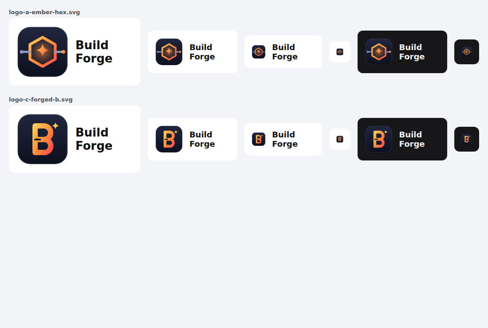

# Build Forge logo

- **`logo-a-ember-hex.svg` (in use)**: a hexagon, the build artifact, glowing like metal in a forge, with a pipeline running
  through it from the left (grey, the work coming in) to the right (ember, the result) and a spark at the centre. It says
  "pipeline" and "forge" without a hammer-and-anvil cliché, and keeps its silhouette at 24 px in the Jenkins sidebar.
- **`logo-c-forged-b.svg` (alternative)**: a bold, forged-metal **B** with a single spark. Stronger at 16 px, but a generic
  letter tile. To switch, copy it over `plugin/src/main/webapp/images/buildforge.svg` and rebuild the plugin.

Colours: ink `#20263f` to `#0c101e` (tile), ember `#ffc857` to `#ff8a3d` to `#ff4d4d`, steel `#8d97bd`. The tile carries its own
background, so the mark works on Jenkins' light and dark themes.
