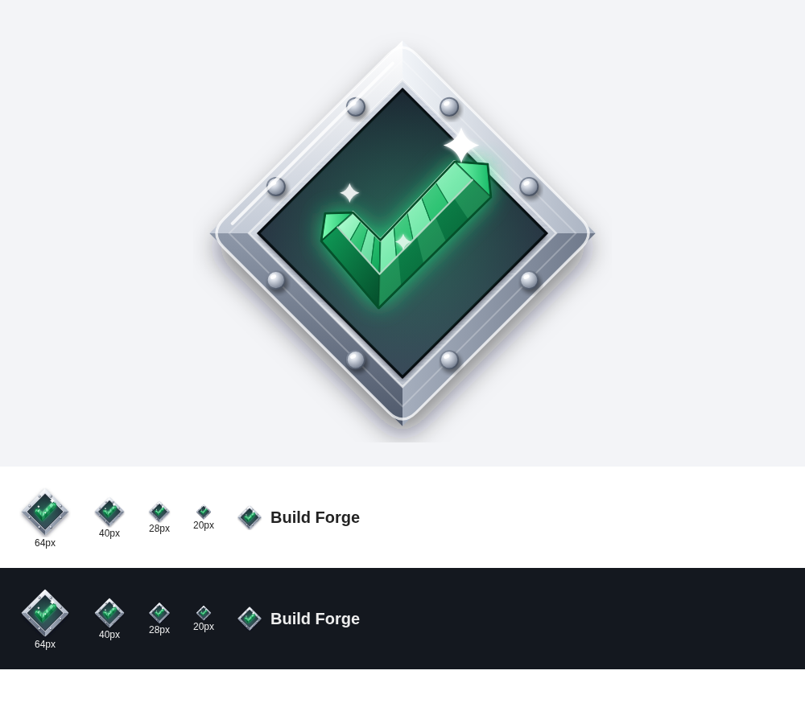

# Build Forge logo

**In use: `logo-steel-diamond.svg`.** A brushed-steel diamond plate with a bevelled frame and eight rivets, and a tick cut like a
green gemstone set in the middle. The plate says "built and verified"; the gem tick says "passed". It is a hand-built vector
illustration with realistic shading (gradients, bevels, a brushed texture, glow), so it scales without blurring.

- The plugin ships `plugin/src/main/webapp/images/buildforge.svg`, the simplified version of the same drawing (no brushed
  texture) so it stays crisp at 20-40 px in the Jenkins sidebar and dashboard header.
- It has a transparent background and its own dark well, so it works on Jenkins' light and dark themes.

Colours: steel `#f4f6f9` to `#8e98a9`, well `#1b2230` to `#3a4558`, gem `#9bffc6` / `#3fe08a` / `#0f9d58` / `#054d2b`.

Alternative kept for reference: `logo-ember-hex-alt.svg` (the 2.2.0 hexagon-and-ember mark). To switch back, copy it over
`plugin/src/main/webapp/images/buildforge.svg` and rebuild the plugin.
